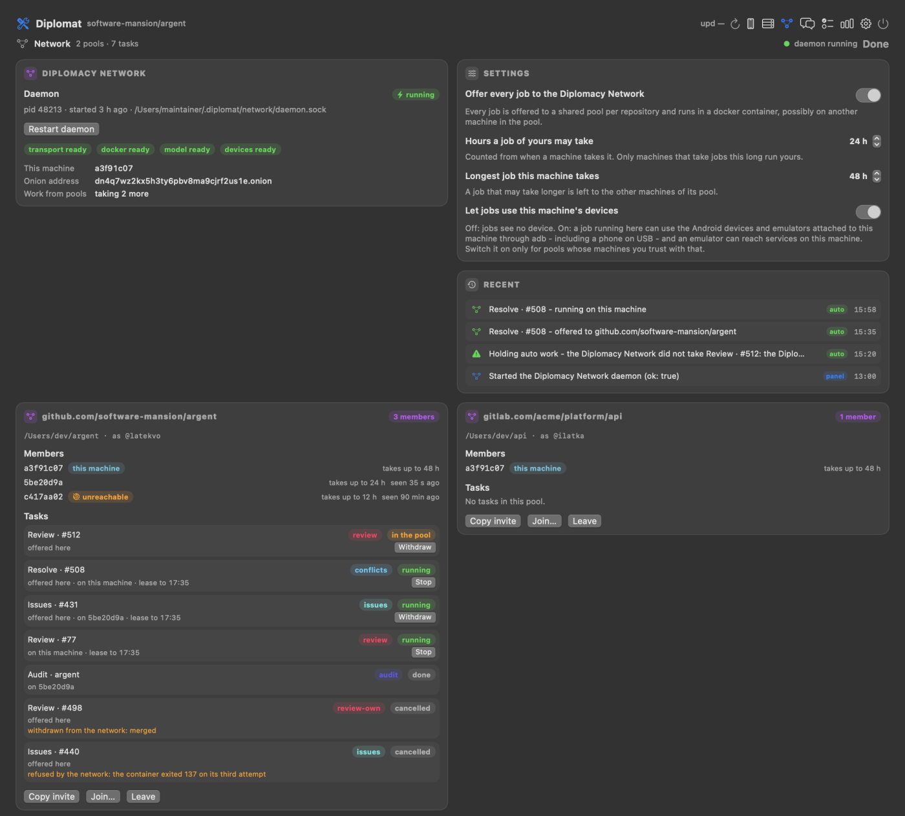

# Diplomacy Network

A peer-to-peer network of Diplomat machines, over Tor, that share the work on the repositories
they have in common. It is off by default. **Settings → Offer every job to the Diplomacy
Network** switches it on, and from then on it gates every job on this machine:

- Diplomat starts no job in a terminal. Every job - a monitor's, the queue's, a wizard's - is
  **offered** to the pool of its repository.
- Some machine in that pool with a free slot **takes** it. That may be this one.
- Whoever takes it runs it in a **docker container**. Your own jobs on your own machine too.
- Everything the agent does on GitHub or GitLab is done by the machine that offered the job,
  **in its operator's name**, and only what that job needs.

The switch gates jobs: agents that work on a repository. Outside it are:

- **Agents already running in terminals** when it is switched on. They run on.
- **The device allocator's repair agent.** A simulator or emulator reported broken gets `claude`
  in a terminal on this machine. It maintains the machine, works on no repository, and stays on
  the host.
- **Model calls that use no tools**: the Comms classifier and its replies, the grouping of tasks
  into goals, and the daemon's renewal of the Claude Code login.
- **The terminals that sign a provider in.**

The daemon behind it is [`diplomacy-network`](../packages/diplomacy-network/README.md); the
contract between two machines is its [PROTOCOL.md](../packages/diplomacy-network/PROTOCOL.md).

A Diplomat with the network replaces the mesh of earlier versions. At launch it ends the mesh
node such a version left running - the process `~/.diplomat/mesh/state.json` names, while that is
a `python -m szpontnet` - and removes `~/.diplomat/mesh` with the keys in it. The feed says so.

It needs `tor` and `docker` on the machine, and `gh` or `glab` signed in for the forge each
repository is on. The daemon looks for them on its `PATH` and in the usual install directories;
`DN_TOR`, `DN_DOCKER`, `DN_GH` and `DN_GLAB` in the environment the daemon starts with name a
binary anywhere else, and `DN_TOOL_DIRS` names other directories to look in. Without docker a machine still offers its jobs and acts for them, and
takes none. Without Tor it reaches no other machine. The Network screen shows what the daemon
says is missing, and while tor, docker or the model credential is missing or failed, or the
daemon does not answer, a red line above the task list says so and opens that screen.

## Pools

One pool per repository, named by where the repository lives (`github.com/owner/repo`). A machine
is in the pools of the repositories linked in Settings (**Repo roots** and **Other repos**) and in
no other.

A pool's state - who is in it, which jobs are open, who is working on what - is a set of signed
records that every member keeps. Members compare a hash of that state and exchange whatever
differs, so no machine is in charge of a pool, and any member may take any job.

A job stays tied to the machine that offered it all the same. Only that machine confirms a
claim, hands out the prompt and the key, performs the forge requests and extends the lease. While
it is asleep or offline none of its unclaimed jobs can be taken, a job of its that is running
loses its forge access at once and is stopped ten minutes after its lease ends, and after a day
away its offers are cancelled. A machine with jobs out has to stay awake.

- **Joining.** The first machine to link a repository has a pool of one. Another machine joins by
  an **invite**: **Copy invite** on the pool's card, sent to the other operator by any means,
  pasted into **Join...** there. An invite is good for a day, and the machine that made it has
  to be reachable when it is used: it is the one that seats the newcomer. A machine can seat
  15 others, and so can each of those the first machine seated, which makes 241 machines the
  most a pool holds.
- **Leaving.** **Leave** stops this machine taking the pool's jobs and offering to it. It stays
  left until **Rejoin**. After a month away the pool no longer knows the machine, and it needs
  an invite again.
- **Reaching each other.** A machine is reachable only as a Tor onion service whose address is
  its own public key, so there are no ports to open and no addresses to exchange. A first
  connection between two machines can take minutes; later ones take about a second.

Every request one machine sends another carries its own proof of work, bound to the sender, the
receiver and that one request. The work a sender owes doubles as its requests pile up, and a
stranger owes far more than a member.

## Taking a job

A machine takes work while it has room: the task cap in Settings, less what it already runs, and
nothing while the disk is low, the budget gate holds, or automatic work is paused. A job started
by hand in the panel is not held to that room: this machine takes it at once when it can take
jobs at all - Tor and docker ready, a Claude credential on the machine - and the job's hours are
within the longest job it takes. Otherwise the job waits in the pool for another machine, and
the Network screen shows what this machine lacks.

To take a job a machine confirms the pool's state with every member, asks every member for a
lock on the job, and commits only when all that answered agreed. A member that does not answer
is recorded as absent. Two machines reaching for one job are told apart by a rank computed from
the job and the machine's key, the same on every machine.

What a machine has - simulators, attached devices, toolchains - is never announced. A machine
weighs it by itself, in one case: a job on an Android project is left for half a minute by a
machine that has no device to give, so that one with a device takes it first. If none does,
the job runs on a machine without. The wait is visible to the pool all the same: a member that
watches when a machine takes such jobs can tell whether it waited.

## Where a job runs

In a container built from one local image: Debian with git, node, python, curl, `gh`, `glab`,
`adb` and the agent itself. The agent is root in it and is told it may install whatever else it
needs. The machine needs Docker 27.1 or newer: a job's network is made in a mode that release
brought, and an older engine takes no job.

- **The agent is Claude Code**, whatever runner Settings selects for terminals. A machine takes
  jobs only with a credential for it: `networkModelToken`, a Claude Code login, or
  `ANTHROPIC_API_KEY` in the daemon's environment. Without one it takes nothing, and the screen
  reads *model missing*.
- **One container per requesting machine and repository.** It runs the jobs that machine asks
  for on that repository while any of them runs, and never another machine's or another
  repository's. When the last of them ends it is removed with everything in it, and the next
  job starts in a new one.
- **No credential is inside it.** Not the forge's, not the model's.
- **It reaches nothing but the broker.** The container sits on an internal network with one
  other: its relay, a second small container that runs no job and carries connections to a proxy
  on the host and nowhere else. Through it: the forge's API and `git push` go
  to the machine that offered the job, on every host the forge takes a login or serves
  repositories on, over https on port 443 and no other way; `git clone` and `fetch` of the
  repository are answered from the host's own mirror, which the machine running the job fills
  with its own git access to the repository - one that cannot clone the repository cannot run
  its jobs; the model's API is forwarded with the
  host's credential added, and its answer comes back without the headers that describe the
  host's account; anything else is tunnelled to the public internet, so installing software
  works. Addresses of the host, of every network one of the host's interfaces is on, of every
  private or otherwise not publicly routed range, IPv4 or IPv6, and of other containers are
  refused. A publicly addressed network the host reaches only by a route - behind a VPN, or
  another subnet of its site - is not known to the broker and is reached like the rest of the
  internet.
- **It gets a bounded share of the host.** 8 GiB of memory, 4 CPUs, 4096 processes and 20 GiB of
  disk per container; per job, 256 connections through the broker, 256 requests on them at a
  time, 32 connections out for the requests the broker carries itself, and 48 MiB of request
  bodies held at a time. A container found holding more disk than that is removed, and the jobs in it
  end as failed attempts; so is one the engine could not measure three looks running.
- **Devices stay on the host, and jobs see none of them** until **Let jobs use this machine's
  devices** is switched on (the Network screen's settings; off by default). With it on, a job
  running here can use the Android devices and emulators attached to this machine through adb -
  a phone on USB included - by a forward opened for that job, and an emulator can reach services
  on this machine. The switch is one for the whole machine, not one per pool: with it on, every
  job this machine takes, from any member of any pool it is in, can do with those devices
  whatever a shell on them can. Switch it on only when every machine in every one of those pools
  is trusted with that. What adb does on this machine itself -
  connecting to an address, pairing, forwarding or reversing a port, stopping its server - is
  refused. It applies to jobs started afterwards.
- **A fuse.** One job gets 5000 model requests or 8 GiB of model traffic on this machine's
  credential, then is refused. The count is the job's own, and a restart of the daemon does not
  start it again. What a job says it used of the model counts toward the budget gate no higher
  than the traffic this machine carried to the model for it.
- **What a job did** is in `~/.diplomat/network/runs/<run id>/log.jsonl` for a day after it
  ended, written by the job itself.

## Acting in your name

The machine that offered a job performs every forge request the agent makes, with its own `gh` or
`glab` login, after checking the request against the rules of that job's kind. The key that lets
an executor ask is handed over once the job is taken, works for that executor and that job only,
and ends with the job. A repository on a GitHub Enterprise Server or on a GitLab of your own is
acted on at its own address, with the login `gh` or `glab` holds for it. GitHub Enterprise Cloud
with data residency (an address under `ghe.com`) is not supported: no job is offered for a
repository there.

| Job | May write |
|---|---|
| Review of someone else's PR | a review with line comments and thread replies on that PR; approve or request changes only where the review policy lets it |
| Answering reviews on your PR | thread replies, resolving threads, fast-forward pushes to that PR's branch when the branch is in the repository itself or in your own fork of it; marking it ready only where the setting allows |
| Conflicts | fast-forward pushes to that PR's branch when the branch is in the repository itself or in your own fork of it |
| Issue | add or remove itself as an assignee, comment on that issue, push one new branch - in the repository itself or in your own fork of it - and fast-forward it, open one draft PR from it |
| Audit | push up to 24 new branches, in the repository itself or in your own fork of it, and fast-forward them, open one draft PR from each; nothing when read-only |
| Investigate | nothing |

**One new branch** is one for the job, not for each attempt and not for each place: what a job
has created, in the repository or in your fork, is kept with the offer, so a second machine
taking the job after the first failed, and the daemon after a restart, go on from the same
count. A branch is the job's own - to push to again, to open its PR from - once the forge has
said it accepted the push that created it. A push the forge declined uses nothing up. One whose
answer never came may have happened, and the forge knows: before the job's next push is judged
the machine asks it for the branch. No such branch, and the count is free again; the branch at
the commit that was sent, and it is the job's own; the branch at some other commit, and it stays
counted and is nobody's to push to. A draft PR is counted the same way. One whose answer never
came is settled before the job opens another, by asking the forge which PRs there are from that
branch, open or closed: none, and the job may open it; any, and that is the job's one. While the
forge does not answer the question, the request that waits on it is refused. The forge's answer
is taken as it stands - a request the forge was still working on when it answered can land
afterwards, and is then not counted.

**Your own fork** is the repository under the account the repository was linked with that the
forge itself calls a fork of this repository. The machine asks the forge whose it is and what it
is a fork of before every push there. A fork held by somebody else, by an organisation or a
group, a fork of a fork and any other repository of yours are out of reach. A PR's branch is
pushed in the fork only when the forge places that PR's branch there, and a push to the fork is
held to everything a push to the repository is, against the fork's own default and protected
branches.

What a job may read is set by its kind too - by what the work needs, in the one repository it
belongs to:

| Read | By |
|---|---|
| The repository's code: files, branches, tags, commits, a comparison of two of them, and what is recorded on a commit - its comments, its statuses, the results of its checks | every job |
| Every PR and issue of the repository, as context: what it says, its state, the comments, reviews and review threads on it | every job |
| The rest of one PR: its changed files, its commits, who was asked to review it, whether it is merged, its labels, events and reactions; on GitLab its versions, pipelines, approvals and draft notes as well | the review, answering-reviews and conflicts job of that PR |
| The rest of one issue: its events, labels and reactions | the issue job of that issue |
| A CI run, its jobs and their logs | every job, for a branch it pushed itself; the three PR jobs, for their PR's branch; audit and investigate, for the default branch |

No job reads a list of CI runs, build artifacts, releases, deployments or environments, the
repository's feed of events, its traffic, contributors or statistics, an archive of the source
(the clone comes from the offering machine's mirror), the repository's lists of labels and
milestones, or the people who can be assigned or mentioned: nothing `gh` or `glab` asks on a
job's behalf needs them. Whether a commit's checks passed is recorded on the commit and is
readable for each one - `gh pr list` and `gh pr status` show it for every PR - while a run and
its log are tied to the run's branch as the table says; the machine asks the forge which branch
a run was for before it hands anything of it over. A GraphQL request is checked by the names
of the fields it asks for, so there the rest of a PR or an issue is readable for each one of
the repository; what no job reads is refused there as well.

Of what lies outside the repository and the repository
points at - the fork a PR comes from, an issue elsewhere that mentions one here - a job is told
what the thing is (number, title, state, address; a fork's name and description) and nothing of
what is inside it, and of the account that offered the job its public name. Nothing else of the
account can be read: no other repository, no organisation, no setting, token or secret.

Of the repository itself a job is told a fixed list of facts - names and addresses, owner,
description, visibility, default branch, language, topics, licence, dates, size, which of its
features are switched on, which ways of merging it accepts - and nothing off the list: not its
tokens, not its other settings, not its branch protection rules. Of a branch it is told whether
the branch is protected and, on GitHub, whether a PR into it must be up to date before a merge.
The list holds whichever way the agent asks, through the forge's REST API or through GraphQL.

Of your account's standing in the repository a job can read exactly this: on GitHub, through
GraphQL, the level of access the account has (`viewerPermission`: read, triage, write, maintain
or admin), which `gh` reads before it opens a PR; on GitLab, in REST answers, whether the
account is subscribed to an MR, an issue or a label (`subscribed`), whether it may merge an MR
(`user.can_merge`), and whether it may approve one and has approved it (`user_can_approve`,
`user_has_approved`). The account's tokens, the detail of its access permission by permission
and the repository's protection settings are not readable.

A GraphQL request is refused whole when it asks for anything off that list, or for anything
else the forge would say about the account that offered the job rather than about the
repository: what that account may do to an issue, a PR or a comment, whether it is subscribed
to one or has read it, its e-mail addresses. Which comments the account wrote is told, because
`gh` asks.
(GitHub serves the commits of a repository's forks through the repository to whoever knows
their id; the rules do not narrow what the forge itself calls part of the repository.)

A request reaches a rule by its plain address only. One that spells the address another way the
forge might also understand - an escaped letter, an added extension, a doubled or trailing
slash, different capitals - is refused, so a rule cannot be walked around by respelling.
GitLab's own spelling of a name that holds a slash - `feature%2Flogin` for the branch
`feature/login`, `src%2Fmain.js` for a file - is taken where GitLab defines it, when a job reads.

No job may merge, close, force-push, delete a branch, push to the default branch or to a branch
the forge reports as protected, push to any repository but this one and your own fork of it, or
touch settings, secrets or releases. No pushed commit may add, change or delete a CI definition,
in any letter case: `.github/workflows/**` on GitHub; `.gitlab-ci.yml`, `.gitlab/ci/**` and the
file the project is set to read its CI configuration from on GitLab - for a push to your fork,
the file either project is set to read. Each commit is held to its parents: at such a path it
must hold exactly what one of them holds. A commit with one parent therefore changes nothing
there. A merge may take a definition, or the lack of one, from any of the commits it merges, and
every commit a push builds on without carrying it must already be on a branch of the repository
pushed to - so a job can bring a CI definition onto its branch exactly as another branch of the
repository has it, which is what merging the base branch does, and in no other form. What CI
runs from the rest of the repository - a script, a Makefile, a file a definition includes from
elsewhere - is a job's to change like any other file. Whether a name that does not exist yet
would be protected once created is left to the forge, which enforces its own rules on the push.

Before it allows a push or a write, the machine asks the forge what the rule depends on: where
the branch is, which branch is the default, who opened the PR, who is assigned, whose a fork is.
Only an answer
that settles the question counts; when the forge is rate-limited, failing or silent, the request
is refused. A refused request comes back to the agent with the reason.

## Hours

A job is leased two hours at a time. Before each lease ends the machine that offered it asks the
executor whether it is still working; an answer extends the lease, silence returns the job to
the pool ten minutes later. A job gets three attempts, on whichever machines take it - the same
one three times in a pool of one - and after the third the offer ends as failed. A machine
that failed at a job or gave it back leaves it to the others for two minutes, twice as long
each time, an hour at most. A start that
fails inside a container that was made is a failed attempt. A job a machine cannot start for a
reason of its own - it cannot fetch the repository, has no engine or image, or cannot make the
container - never ran: it goes back to the pool at no cost to its three attempts, and the
machine takes no job of that repository for a minute, twice as long after each such failure in
a row, ten minutes at most.

- **Hours a job of yours may take** - the limit from start to finish. Sent with every job.
- **Longest job this machine takes** - jobs allowed longer are left to other machines. Announced
  when joining a pool.

The two are independent. With the first above the second this machine takes none of its own
jobs, and the screen says so beside the fields.

Both are whole hours from 12 to 720 (30 days). A value written into `config.json` by hand is
read the same way by Diplomat and by the daemon: rounded to the nearest whole hour, below 12 as
12, above 720 as 720, and 12 when it is no number.

## The Network screen

Opened with the network button in the panel header. The daemon and whether Tor, docker, the
model credential and the devices are ready; this machine's key and onion address; how much work
it is taking and why not; the two hours settings and the devices switch; the network's lines of
the activity feed; and a card per pool with its members (last seen, unreachable) and jobs (kind,
state, where it runs, lease end). A job row offers **Stop** for a run on this machine - the job
goes back to the pool - or **Withdraw** for one this machine offered that runs elsewhere or
nowhere yet. **Stop** asks the daemon what runs here first: a run that ended since the screen
drew it is neither stopped nor withdrawn, and the card says so. **Restart daemon** leaves the
jobs in this machine's containers running; the daemon that starts takes them up.

The daemon leaves a pool that is missing from the list Diplomat gives it, so what Diplomat
cannot confirm is never dropped from that list. A repo root or a checkout under Other repos
that cannot be read (a missing path, a volume not mounted, `git` failing on it) and a repository
whose login on its forge is not known yet keep the pool the daemon last had for them, and the
screen names each one and what ends it: */path cannot be read: its pool stays as the daemon
last had it until the path can be read or is taken out of Settings*, or *The login for
owner/repo on host is not known yet*. Every other pool follows Settings on the next cycle while
that lasts: a repository linked since gains its pool, one taken out leaves its own, and the
feed names each pool left and why. A root or a folder that was read and has no GitHub or GitLab
remote is no pool and holds nothing back; a self-hosted GitLab is recognised by a host name
starting with `gitlab.` or by `glab` being signed in to it. A list the daemon refuses is shown
with the daemon's own sentence and sent again once a minute, or as soon as it changes.

A job offered to the network shows in the task list like any other: *in the pool*, *running on
this machine* or on another member's key, then finished or failed. A job started by hand whose
offer the daemon has not answered yet reads *Offering to the pool…* until it has. Telemetry
prices a job from what the executor reports; work another machine ran counts against no limit of
this one. A job that took more than one attempt is priced from the last alone: what an earlier
attempt spent is in no figure.

Work that was asked for - a sweep's PRs, a goal's fixes and reviews, a request from Slack - is
answered by a job that ran, not by its offer:

- A job that **finished** answers it. So does one the network gave up on with its three attempts
  used (*refused by the network*, or *failed on* a machine): it ran and came to nothing, as an
  agent in a terminal can, and is not offered again.
- Taking the offer back yourself ends it too: **Withdraw** on the Network screen, or the row's
  ✕ in the task list. A goal that leaves auto takes back its own offers no machine has taken.
- An offer that ends any other way without having run - its pool left or closed, the network
  switched off, a daemon that no longer holds it - leaves what was asked for standing, and it is
  offered again on the next poll.

The daemon keeps an ended offer for a day. A job that ended while Diplomat was not running for
longer than that reads *the network holds no such offer* when Diplomat is back: it is not
priced, and what asked for it is offered again.

A `config.json` that is there and cannot be read as settings switches nothing. Diplomat keeps
the switch as it last read it, withdraws and starts nothing on that reading, saves no setting
over the file, and says so in the feed. The daemon takes five such reads, a second apart, and
then stops as it does when switched off; Diplomat still starts no agent in a terminal, and the
panel's red line says when the daemon does not answer.

Switching the network off withdraws this machine's open offers, stops the jobs it runs for the
pool and frees their PRs and issues for agents in terminals again. The daemon removes its
containers, mirrors and run records and exits; the machine's key, its pools and the image stay,
so switched on again it is the member it was. Work that was asked for and
had not run is started in a terminal from the queue on the next poll. A monitor's own find
counts its offer as an attempt, so it is started again on that monitor's retry schedule. A job
started by hand whose offer the daemon had not answered is withdrawn if the daemon turns out to
hold it; of any other the feed says that it was not offered, and it is started nowhere.

## What it does not protect against

- **An executor sees what its job may see.** A machine that takes your job can read your
  repository through it, and can write what the job's kind allows - comments in your name, commits
  on the job's branch. Pushed code runs in whatever CI the repository already has. Invite
  machines you would give that to.
- **Your model quota runs your pool's jobs.** A job this machine takes spends this machine's
  model credential, up to the fuse.
- **Jobs of one requester on one repository that run at the same time share a container** and
  can see each other: each can read and change the other's files, and can read and use the
  other's key for that requester while both run. A job that starts while another still runs
  joins that container, with whatever the jobs before it left there. A process a job leaves
  behind lives until the last of them ends. Then the container is removed with its files, and a
  job that starts after that finds nothing of them.
- **What is public on the forge is the internet.** The hosts a forge hands downloads out from,
  and any site by its bare address, are reached like any other site: a job can fetch another
  public repository's files there without the requester seeing it. Nothing private opens that
  way, since no container holds a credential.
- **A sleeping member counts as absent**, so a job can be taken without it. The machine that
  offered the job hands out one key per job, which is what keeps two executors from acting on it.
- **A job needs its offering machine awake.** Asleep, it hands out no key and performs no forge
  request, so its jobs stand still or stop (see Pools).
- **A split pool can run a job twice.** When two machines that both offered the same job lose
  sight of each other, each side can hand it to an executor of its own until they meet again.
- **Pools are small.** A pool's whole state travels in one message; it is built for the handful
  of machines and the tens of open jobs a team has, not for thousands.
- **macOS and Xcode toolchains** are not in a Linux container. A job that must build for Apple
  platforms needs a machine whose operator has arranged that; the network does not provide it.
